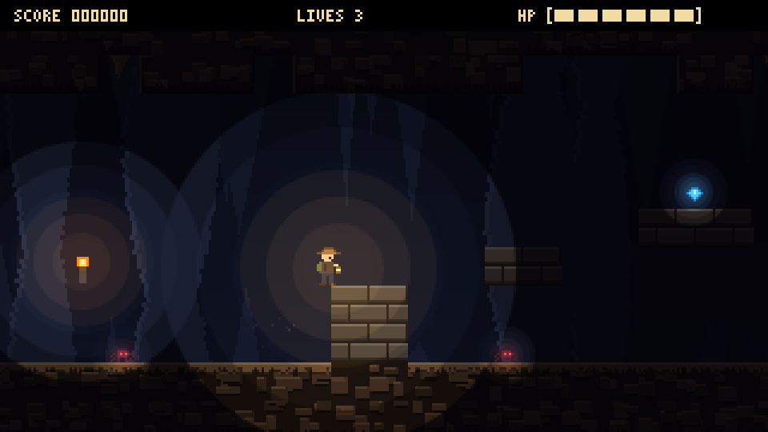

# Deepgleam

**English** | [Deutsch](README.de.md)

### ▶ [Play here](https://mngmcom.github.io/Deepgleam/)

Or [download the ZIP](https://github.com/mngmcom/Deepgleam/releases/latest), unpack it and open `index.html` in your browser.

A small pixel-art side-scrolling platformer that runs right in the browser.
An explorer carrying a lantern makes their way through eight dark caves in four cave worlds, searching for a lost treasure of gold.

## Getting started

Open `index.html` in a browser. No server, build step or dependencies needed.

## Controls

| Key | Action |
|---|---|
| Left / Right arrow, A / D | Run |
| Space, W, Up arrow | Jump (hold longer to jump higher) |
| Down arrow, S | Drop through a plank |
| P, Esc | Pause |
| M | Sound on / off |
| Enter | Start / Continue / Restart |

## The levels

The game has 8 levels in 4 cave worlds. Each world has its own color palette and its own monster, and consists of two consecutive levels, the second being a bit harder. Every level contains one special item. Twice per level the path steps down, so the exit lies deeper than the start. The first seven levels end at an exit, the last one at the treasure chest.

| Level | World | Special monster | Special item | Features |
|---|---|---|---|---|
| 1 Erdhöhle 2 Alte Stollen | Earth | Spider and bat | Double gold Shield | Spikes, chasms, falling stalactites, wooden scaffolding |
| 3 Kristallgrotte 4 Kristallhallen | Crystal | **Crystal beetle**: extends crystal spikes at regular intervals. Can only be defeated while the spikes are retracted. They flash briefly before coming out. | Shield Double gold | Glowing crystals, crystal spikes, beetles on narrow bridges |
| 5 Pilzgrotte 6 Sporenwald | Fungus | **Spore mushroom**: fires poison spores at the player. Can be defeated by jumping on its head. | Shield Double gold | Glowing mushrooms, thorns, bog bridge |
| 7 Lavahöhle 8 Feuerschlund | Lava | **Ember**: leaps out of the lava and cannot be defeated. Bubbling lava announces it. | Double gold Shield | Deadly lava, crumbling platforms that break apart shortly after you step on them, basalt columns |

The level names are in German, as they appear in the game.

  
  
  

## How to play

- The cave is dark. Only the lantern's circle of light and glowing things like torches, crystals or lava show the way.
- **Gold** is worth 50 points, **gems** 250, defeated monsters 100 to 200.
- Defeat enemies by jumping on their heads. Touching them from the side costs HP.
- Every level holds one **special item**. The top left of the screen shows how long it lasts, and the display flashes shortly before it runs out.
  - **Shield** (blue): invulnerable for 8 seconds. Spikes, spores and stalactites do no damage, and monsters are defeated on contact. The ember becomes harmless but stays undefeatable. Chasms and lava are still deadly.
  - **Double gold** (gold coin with a 2): for 12 seconds every gold nugget is worth 100 points instead of 50.
  - Losing a life also ends the effect. A collected item does not come back.
- **Extra life** (red heart): levels 4 (Kristallhallen) and 8 (Feuerschlund) each hold a heart that gives you one more life.
- **Checkpoints** (lanterns on a post) set your respawn point and refill your HP.
- You lose a life at 0 HP or when you fall into a chasm or the lava.
- Finishing a level earns 1000 bonus points plus 100 per remaining HP. The treasure chest at the end gives a big bonus.
- After a game over you restart the current level with 3 lives. Your score resets to what it was at the start of the level.
- The high score is saved in the browser (`localStorage`).

## Project layout

| File | Contents |
|---|---|
| `index.html` | Page with the canvas, scaled pixel-perfect to the window size |
| `level.js` | Level data as text: name, color theme and sections for each level |
| `game.js` | Game logic, graphics, lighting and sound |
| `README.md`, `README.de.md` | This guide in English and German |
| `CHANGELOG.md` | Changes per version (in German) |
| `.github/workflows/release.yml` | On every push to `main`, builds a release with a ZIP download; on pull requests, only a test ZIP |

Tech: plain JavaScript with HTML5 Canvas, internal resolution 320×180 pixels with 16×16 tiles. All graphics and sound effects are generated in code (pixel sprites from strings, sounds via the Web Audio API).

## Editing levels

The levels live in `level.js` in the `LEVELS` list. Each level has a name, a color theme (`theme`: `earth`, `crystal`, `fungus` or `lava`) and sections that are joined from left to right. Each section has 12 rows, and one character is one tile. Row 9 is the normal walking level.

| Char | Meaning | Char | Meaning |
|---|---|---|---|
| `#` | Rock | `B` | Stone brick |
| `=` | Wooden plank (can be jumped through from below) | `%` | Crumbling platform |
| `^` | Spikes | `~` | Lava |
| `\|` | Wooden beam (decoration) | `.` | Air |
| `P` | Start point | `C` | Checkpoint |
| `E` | Exit to the next level | `T` | Treasure chest (goal of the game) |
| `o` | Gold nugget | `*` | Gem |
| `f` | Wall torch | `v` | Stalactite |
| `x` | Glowing crystal (decoration) | `m` | Glowing mushroom (decoration) |
| `s` | Spider | `b` | Bat |
| `K` | Crystal beetle | `G` | Spore mushroom |
| `L` | Ember (place it in the lava) | `S` | Shield (invulnerable) |
| `D` | Double gold (gold counts double) | `H` | Extra life |

To lead deeper into the cave, write a section as `down(2, [ ... ])` instead of `[ ... ]`. That section and all following ones then sit 2 tiles lower. The game fills the space above with rock and the space below with the section's last row, so chasms stay open. So that the player can walk down, the left edge of the lower section should be free in rows 6 and 7.

A new level is simply another entry in `LEVELS`. The order of the list is the order of play. The last level should end with the treasure chest `T`, all others with an exit `E`. The player character jumps about 3 tiles high and 3 to 4 tiles far. For that it needs about 4 tiles of headroom above the take-off point. If the ceiling hangs lower, the jump is cut short and the distance drops noticeably.

### Testing in the browser console

| Command | Effect |
|---|---|
| `deepgleam.level(3)` | Jump straight to level 3 |
| `deepgleam.teleport(120, 9)` | Move to tile column and row |
| `deepgleam.god = true` | Take no damage (lava and chasms are still deadly) |

## Tuning

Game feel and difficulty can be adjusted with the constants at the top of `game.js`:
`RUN` (running speed), `JUMP_V` (jump strength), `GRAV` (gravity), `MAX_HP`, `START_LIVES`, plus `SHIELD_TIME` and `DOUBLE_TIME` (how long the special items last, in seconds).
The level colors are in `THEMES` in `game.js`.

## Changes

What changed in which version is listed in [CHANGELOG.md](CHANGELOG.md) (in German).

This guide is also available in German: [README.de.md](README.de.md). When making changes, please update both versions.

## License

Released under the [MIT License](LICENSE). You may freely use, modify and share the code as long as the copyright notice is kept.
