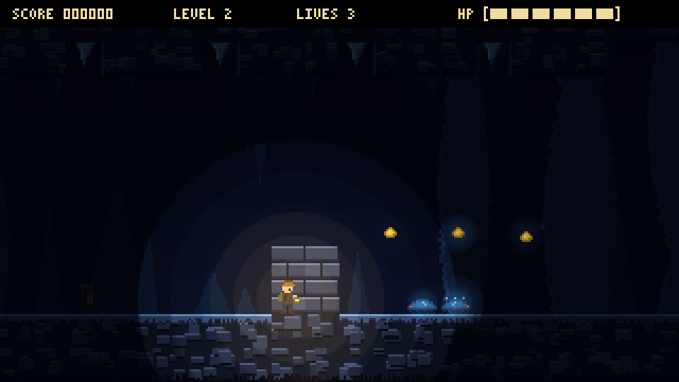
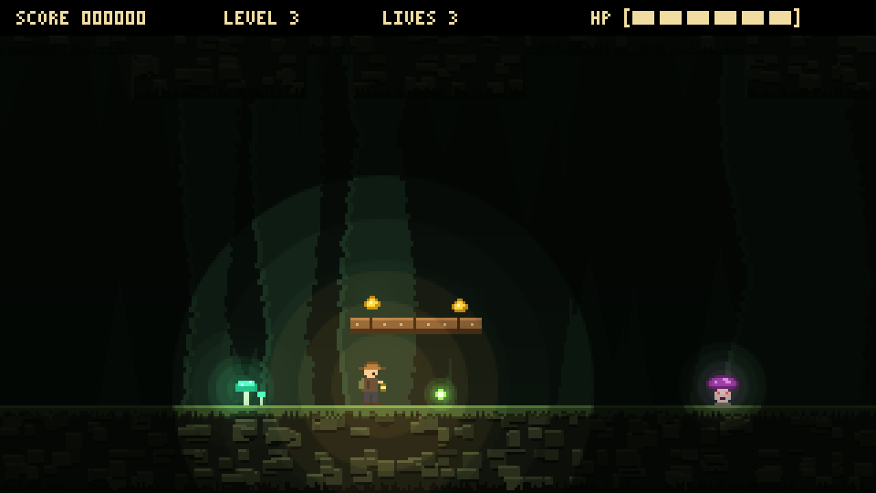
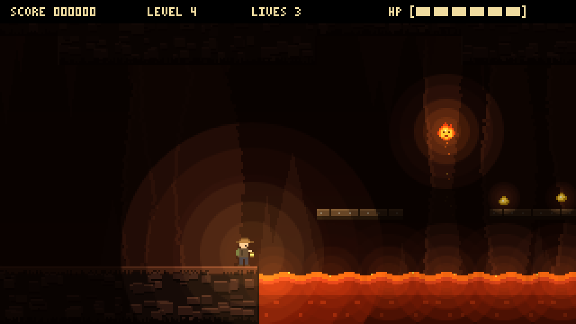

# Deepgleam

### ▶ [Hier spielen](https://mngmcom.github.io/Deepgleam/)

Oder [als ZIP herunterladen](https://github.com/mngmcom/Deepgleam/releases/latest), entpacken und `index.html` im Browser öffnen.

Ein kleines Side-Scrolling-Jump-and-Run im Pixel-Look, das direkt im Browser läuft.
Ein Abenteurer erkundet mit seiner Laterne vier dunkle Höhlen und sucht einen verlorenen Goldschatz.

## Starten

`index.html` im Browser öffnen. Es braucht weder einen Server noch einen Build-Schritt oder Abhängigkeiten.

## Steuerung

| Taste | Aktion |
|---|---|
| Pfeil links / rechts, A / D | Laufen |
| Leertaste, W, Pfeil hoch | Springen (länger halten = höher) |
| Pfeil runter, S | Durch eine Planke fallen |
| P, Esc | Pause |
| M | Ton an / aus |
| Enter | Start / Weiter / Neustart |

## Die Level

Jedes Level hat eine eigene Farbwelt, ein eigenes Monster und ein Spezial-Item. Die ersten drei enden an einem Ausgang, das letzte an der Schatztruhe.

| Level | Name | Spezial-Monster | Spezial-Item | Besonderheiten |
|---|---|---|---|---|
| 1 | Erdhöhle | Spinne und Fledermaus | Doppelgold | Stacheln, Abgründe, fallende Stalaktiten |
| 2 | Kristallgrotte | **Kristallkäfer**: fährt regelmäßig Kristallstacheln aus. Nur besiegbar, wenn die Stacheln eingefahren sind. Kurz vorher blinken sie auf. | Schild | leuchtende Kristalle, Kristallstacheln |
| 3 | Pilzgrotte | **Sporenpilz**: schießt Giftsporen gezielt auf den Spieler. Per Kopfsprung besiegbar. | Schild | leuchtende Pilze, Dornen |
| 4 | Lavahöhle | **Glutling**: springt aus der Lava hoch und ist nicht besiegbar. Blubbernde Lava kündigt ihn an. | Doppelgold | tödliche Lava, Bröckelplatten, die kurz nach dem Betreten zerfallen |

  
  
  

## Spielprinzip

- Die Höhle ist dunkel. Nur der Lichtkreis der Laterne und leuchtende Dinge wie Fackeln, Kristalle oder Lava zeigen den Weg.
- **Gold** bringt 50 Punkte, **Edelsteine** 250, besiegte Monster 100 bis 200.
- Gegner besiegt man mit einem Sprung auf den Kopf. Seitliche Berührung kostet HP.
- In jedem Level liegt ein **Spezial-Item**. Oben links im Bild steht, wie lange es noch wirkt. Kurz vor dem Ende blinkt die Anzeige.
  - **Schild** (blau): 8 Sekunden unverwundbar. Stacheln, Sporen und Stalaktiten richten keinen Schaden an, Monster werden bei Berührung besiegt. Der Glutling ist harmlos, bleibt aber unbesiegbar. Abgründe und Lava bleiben tödlich.
  - **Doppelgold** (Goldmünze mit 2): 12 Sekunden lang bringt jedes Goldnugget 100 statt 50 Punkte.
  - Wer ein Leben verliert, verliert auch die Wirkung. Ein eingesammeltes Item kommt nicht zurück.
- **Checkpoints** (Laternen am Pfahl) speichern den Wiedereinstieg und füllen die HP auf.
- Bei 0 HP, einem Sturz in den Abgrund oder in die Lava geht ein Leben verloren.
- Ein abgeschlossenes Level bringt 1000 Bonuspunkte plus 100 je übrigem HP. Die Schatztruhe am Ende bringt einen großen Bonus.
- Nach einem Game Over startet man das aktuelle Level mit 3 Leben neu. Die Punkte springen auf den Stand zu Levelbeginn zurück.
- Der Highscore wird im Browser gespeichert (`localStorage`).

## Projektaufbau

| Datei | Inhalt |
|---|---|
| `index.html` | Seite mit dem Canvas, skaliert pixelgenau auf die Fenstergröße |
| `level.js` | Leveldaten als Text: Name, Farbwelt und Abschnitte je Level |
| `game.js` | Spiellogik, Grafik, Licht und Sound |
| `.github/workflows/release.yml` | baut bei jedem Push auf `main` eine Release mit ZIP-Download, bei Pull Requests nur eine Test-ZIP |

Technik: reines JavaScript mit HTML5 Canvas, interne Auflösung 320×180 Pixel bei 16×16-Kacheln. Alle Grafiken und Soundeffekte werden im Code erzeugt (Pixel-Sprites aus Zeichenketten, Töne über die Web Audio API).

## Level bearbeiten

Die Level stehen in `level.js` in der Liste `LEVELS`. Jedes Level hat einen Namen, eine Farbwelt (`theme`: `earth`, `crystal`, `fungus` oder `lava`) und Abschnitte, die von links nach rechts aneinandergehängt werden. Jeder Abschnitt hat 12 Zeilen, ein Zeichen entspricht einer Kachel. Zeile 9 ist die normale Laufebene.

| Zeichen | Bedeutung | Zeichen | Bedeutung |
|---|---|---|---|
| `#` | Fels | `B` | Steinziegel |
| `=` | Holzplanke (von unten durchspringbar) | `%` | Bröckelplatte |
| `^` | Stacheln | `~` | Lava |
| `\|` | Holzbalken (Deko) | `.` | Luft |
| `P` | Startpunkt | `C` | Checkpoint |
| `E` | Ausgang zum nächsten Level | `T` | Schatztruhe (Spielziel) |
| `o` | Goldnugget | `*` | Edelstein |
| `f` | Wandfackel | `v` | Stalaktit |
| `x` | Leuchtkristall (Deko) | `m` | Leuchtpilz (Deko) |
| `s` | Spinne | `b` | Fledermaus |
| `K` | Kristallkäfer | `G` | Sporenpilz |
| `L` | Glutling (in die Lava setzen) | `S` | Schild (unverwundbar) |
| `D` | Doppelgold (Gold zählt doppelt) | | |

Ein neues Level ist einfach ein weiterer Eintrag in `LEVELS`. Die Spielfigur springt etwa 3 Kacheln hoch und 3 bis 4 Kacheln weit. Dafür braucht sie über dem Absprung etwa 4 Kacheln Platz nach oben. Hängt die Decke tiefer, bricht der Sprung früher ab und die Weite sinkt deutlich.

### Testen in der Browser-Konsole

| Befehl | Wirkung |
|---|---|
| `deepgleam.level(3)` | direkt zu Level 3 springen |
| `deepgleam.teleport(120, 9)` | an Kachelspalte und -zeile versetzen |
| `deepgleam.god = true` | keinen Schaden nehmen (Lava und Abgründe bleiben tödlich) |

## Anpassen

Spielgefühl und Schwierigkeit lassen sich über die Konstanten am Anfang von `game.js` einstellen:
`RUN` (Laufgeschwindigkeit), `JUMP_V` (Sprungkraft), `GRAV` (Schwerkraft), `MAX_HP`, `START_LIVES` sowie `SHIELD_TIME` und `DOUBLE_TIME` (Wirkdauer der Spezial-Items in Sekunden).
Die Farben der Level stehen in `THEMES` in `game.js`.

## Lizenz

Veröffentlicht unter der [MIT-Lizenz](LICENSE). Der Code darf frei genutzt, verändert und weitergegeben werden, solange der Copyright-Hinweis erhalten bleibt.
